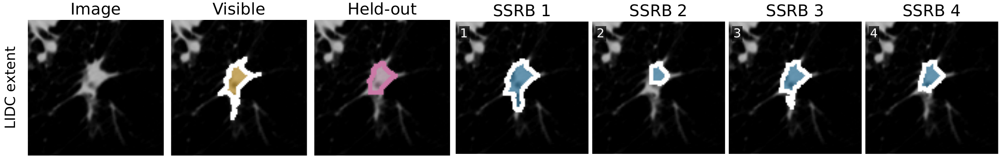

# Example predictions

The figure shows one LIDC nodule crop from the paper. Gold marks the fixed visible annotation, pink marks the held-out annotation, and blue marks the first four of eight SSRB predictions in score order. The masks show alternative nodule extents; the scores are not probabilities of annotator choices.

This is the LIDC row of the paper's qualitative figure. Within visible seed 0 and optimizer seed 0, the case was selected by its proximity to the median Dice between the semantic and SSRB masks. The row and its labels were rendered from the paper figure without changing the predictions. Other dataset rows were omitted.

## Attribution and license

The illustration is shared under [Creative Commons Attribution 3.0 Unported](https://creativecommons.org/licenses/by/3.0/). It adapts the following TCIA materials by cropping the image, displaying annotation overlays and adding SSRB predictions and labels. This applies to the illustration; the SSRB code uses the repository's MIT license.

- Armato III, S. G., et al. (2015). *Data From LIDC-IDRI*. The Cancer Imaging Archive. [Data DOI](https://doi.org/10.7937/K9/TCIA.2015.LO9QL9SX).
- Fedorov, A., Hancock, M., Clunie, D., Brockhhausen, M., Bona, J., Kirby, J., Freymann, J., Aerts, H. J. W. L., Kikinis, R., and Prior, F. (2018). *Standardized representation of the TCIA LIDC-IDRI annotations using DICOM*. The Cancer Imaging Archive. [Data DOI](https://doi.org/10.7937/TCIA.2018.h7umfurq).
- Armato, S. G., III, et al. (2011). *The Lung Image Database Consortium (LIDC) and Image Database Resource Initiative (IDRI): A completed reference database of lung nodules on CT scans*. Medical Physics, 38, 915-931. [Publication DOI](https://doi.org/10.1118/1.3528204).
- Fedorov, A., et al. (2020). *DICOM re-encoding of volumetrically annotated Lung Imaging Database Consortium (LIDC) nodules*. Medical Physics. [Publication DOI](https://doi.org/10.1002/mp.14445).

We acknowledge the National Cancer Institute and the Foundation for the National Institutes of Health for supporting creation of the LIDC/IDRI database.

The [LIDC-IDRI collection](https://www.cancerimagingarchive.net/collection/lidc-idri/) and [DICOM annotation collection](https://www.cancerimagingarchive.net/analysis-result/dicom-lidc-idri-nodules/) list CC BY 3.0. Reuse must preserve attribution and follow the [TCIA data usage policy](https://www.cancerimagingarchive.net/data-usage-policies-and-restrictions/).

To render mask banks from your own saved predictions, use `ssrb plot-banks` as described in [PAPER_ANALYSIS.md](../docs/PAPER_ANALYSIS.md).
